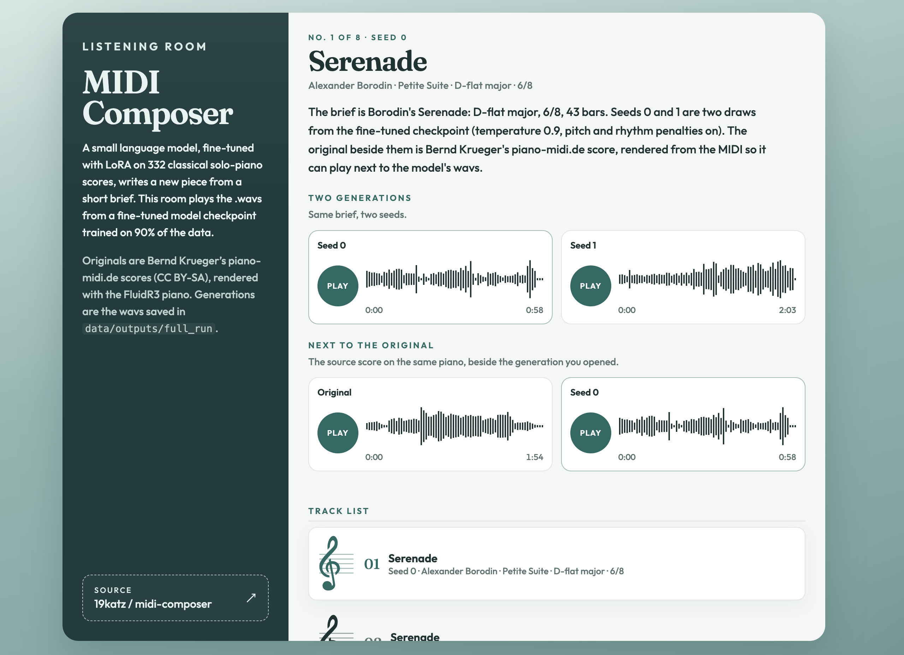

# midi-composer

I fine-tuned a small language model to write classical solo piano. The training set is 332
score-aligned MIDI files. When it generates, it continues from a short brief: the key, the
meter, the length, and a description of the music.

You can hear the results in the [listening room](web/). Training and generation run in the
[Colab notebook](https://colab.research.google.com/github/19katz/midi-composer/blob/main/notebooks/midi_composer_colab.ipynb).
You can listen to the full generation results on the test set, as well as the
custom-created piece, [here](https://drive.google.com/drive/folders/1OzHyS5fATVBeuYv3xYN7F4Gn8destLQm).

## About this project

### Why music generation?

Twelve years ago, I attended the Workshop on Algorithmic Music Composition (WACM) at UC Santa Cruz. There, I built an algorithmic composer that used
Markov Chain Monte Carlo to create Bach chorales.

Since then, I've been able to watch natural language processing
and reasoning evolve in real time, from building a long document summarizer
as a final project in my grad-level NLP courses to seeing that problem become
virtually obsolete with the advent of large language models.

Now that software engineering has been completely changed by LLMs, I wanted
to revisit this project to understand how, with limited resources, I could build an algorithmic composer similar to the one I developed years ago,
but with the technology available today.

Using Qwen 2.5 (3 billion parameters) and LoRA, which allows for greater efficiency and lets us train on a new task quickly while still keeping all the
larger benefits of an LLM, I split the original 300+ set of midi files into
a train and test set, tokenized the pieces, fine-tuned the model, and 

### What I learned

I can divide what I learned into two main categories: what I learned about
machine learning, LLMs, and fine-tuning; and what I learned about the process
of composing and creating music.

#### About ML

- *Tokenizing and data quality still matter*: My initial results were choppy, rhythmically jerky, and highly unnatural. I spent several iterations tweaking my tokenization process and figuring out how to best represent concepts like notes, chords, and keys. My first attempts often had too many tokens or too loose of a representation (e.g. one token per tempo speed, multiple ways to represent the same note or sequence of notes), leading to glaring errors (too many empty bars, the disappearance of a melody entirely, etc.)
- *Context windows also matter*: As with the tokenization, a large consideration I had to make was to not blow up the context window when generating the piece, but also provide enough context for the model to create something that progressed in a meaningful way. As LLMs get more advanced, it becomes more and more possible to just close your eyes and let the agent take the wheel, but understanding what concepts are important to these models can be the difference between getting something real out of your LLM usage experience and getting a hallucination.
- *Meaningful loss*: I made some tweaks to the cross-entropy loss function by weighting tokens corresponding to the overall bar's trajectory rather than just individual notes more. Weighting things like the bar, chords, rhythm, and tempo more meant that improvements in my loss function led to improvements in what was hard (generating a musical piece that is coherent and has a progression).

#### About music composition
- *The process by which humans and machines write music is fundamentally different*: This goes even down to the most base level of tokenization. Having read music my whole life, I was surprised to find that even quirks of notation that come second-nature to me, like the same note as a C# and Db depending on context, could make a big difference in the model's performance because it made a big difference on the vocabulary.
- *The cadence and story of a piece are the hardest to capture*: It's pretty easy and even methodical to create a way of encoding musical pieces such
that the LLM generates something in-key where individual bars are in-key. However, much as LLMs can hallucinate information, it's possible for them to get stuck in loops repeating the same rhythms or failing to conclude musical sequences. I'm sure playing with the amount of context could give me better results, but there is a lot of improvement to be made here.
- *When to rest?* I gained a newfound appreciation for dynamics, rests, and other tempo markers. These lend such a sense of feeling and emotion to the music and were really difficult for the LLM to capture. Constraints on generation could only do so much here.
- *The more contemporary the composer, the harder to capture*: We often find that the way LLMs work defy how we as people reason (see point #1 about how humans and machines process music best in different ways). However, as contemporary composers became more experimental, less tonal, and less rules-based, LLM-based generation also suffered. Much as Markov Chain Monte Carlo can create lovely Bach chorales due to their rigid properties of counterpoint, we also saw better results from the LLM with more structured pieces from earlier composers. 
- *Computer-based composition can help us understand the work of humans, not devalue it*: This was an interesting experiment and a great microcosm for how we can utilize LLMs to understand the existing human compositions we have. I had to really consider what makes a piece of music or an artist's style recognizable, unique, and resonant, and I wouldn't say that I've captured even close to all of it. Instead of coming away from this project dismissive of the music of these composers, I'm only more fascinated by the complexity of the human brain and what we can create.

## A sample

The last cell of the notebook writes one piece from a prompt, rather than from a score
in the test set. I asked for a melancholy nocturne in C-sharp minor: a singing right
hand over a rocking left hand, a middle that grows more agitated and chromatic, a climax
around two thirds of the way through, and a quiet, consoling close.

What you hear is that generation, seed 0 from the step 507 checkpoint. GitHub starts
the player muted, so turn the sound on. The same recording is on the shelf in the
listening room, and the file is [sample/nocturne.mp4](sample/nocturne.mp4).

https://github.com/user-attachments/assets/6664e0fb-2dcb-499b-b6be-66a6c168783c

## Approach

I wanted a model that could read a sentence and answer with a piano score. A language
model already knows how to continue text, so I turned the score into text and taught it
that format with a small adapter.

1. **The MIDI becomes a score in text.** Each file is one token per musical fact: the
   key, the bar, a scale degree and an octave, a tempo bin, whether the bar repeats the
   previous rhythm, and which notes are the melody. The highest right-hand note at an
   attack is the melody line. The rest of the chord stays in the right hand, and the
   decoder puts the melody back on that staff. Pedal is on or off. One sounding pitch
   has one spelling, so the model is spared choosing between C-sharp and D-flat.
2. **A description is paired with that score.** When I have a Gemini key, the notebook
   writes a brief from the audio. Otherwise it builds a fallback from the header: key,
   meter, tempo, and length.
3. **Qwen2.5-3B learns the score, and the base model stays frozen.** I add the music
   tokens to the vocabulary before LoRA. Training updates low-rank adapters on attention
   and the MLP, plus the new rows of the embedding and output matrices. The loss is on
   the score the model writes, with extra weight on harmony, rhythm, tempo, phrase, and
   the melody. The English brief stays on Qwen's ordinary vocabulary.
4. **Generation stays inside the loaded context.** A full piece is much longer than one
   training window, so composition proceeds window by window and stops at the planned
   bar count. Soft penalties pull pitch and rhythm toward the corpus. A chromatic note
   and a repeated beat can still be sampled. The hard stops are an onset that falls past
   the bar, and a tempo token far from the previous bar.
5. **I judge a run against the piece it was asked to continue.** For each held-out work
   the notebook draws three seeds, keeps one, and compares diatonic rate, rhythm
   repetition, silence, and tempo jumps with that work's original. I stop when those
   four numbers stop moving toward the originals.

The recordings on the shelf are step 507 of the full run (`full_tok2`), sampled at
temperature 0.9 with those penalties on.

## Listening room

`web/` is a small page that plays the wavs. The full run saved wavs, and the source
MIDI for each original lives outside the repo, in `~/Downloads/MIDI`. I rendered those
MIDI files with FluidR3, the same piano the run uses, at 22050 Hz, so an original and a
generation can sit in one player.



The shelf is the same recordings looked at three ways:

- **Track list.** Every generation from the step 507 run: Borodin's Serenade (seeds 0
  and 1), Chopin's Prelude No. 21 (seeds 0 and 1), Debussy's Menuet (seed 0), Grieg's
  March of the Dwarfs (seed 1), Ravel's Noctuelles (seed 0), and the nocturne from the
  new brief.
- **Two generations.** Where the run kept two seeds of one brief, they play side by side.
- **Next to the original.** The open generation plays beside Bernd Krueger's
  piano-midi.de score. The nocturne has no original, because that brief was new.

```sh
cd web
npm install
npm run dev
```

A recording is a folder under `web/pieces/`:

```
web/pieces/01-borodin-serenade/about.txt
web/pieces/01-borodin-serenade/seed-0.wav
web/pieces/01-borodin-serenade/seed-1.wav
web/pieces/01-borodin-serenade/original.wav
```

`about.txt` is a title, a credit line, a blank line, then the note shown beside the
players. Arrow keys move through the track list. Space plays the open generation.
Starting a second player pauses the one already running.

The originals are CC BY-SA scores by Bernd Krueger (piano-midi.de). The generations
are the model's.

## Run the training

Open the [Colab notebook](https://colab.research.google.com/github/19katz/midi-composer/blob/main/notebooks/midi_composer_colab.ipynb)
on a GPU runtime. It is self-contained: the `midicomposer` package is written out by
`%%writefile` cells, so Colab does not need this repo cloned. `notebooks/pipeline.ipynb`
is the same pipeline and does clone the repo, which I find handier while developing.
After changing `src/` or `pipeline.ipynb`, regenerate the standalone copy:

```sh
python scripts/build_standalone.py
```

- MIDI files go in Google Drive at `MyDrive/MIDI/`.
- A Colab secret `GEMINI_API_KEY` turns on real descriptions. Without it, the notebook
  uses the fallback briefs.
- Run once with `SMOKE_TEST = True`, then set it to `False` for a full run.

A checkpoint under `checkpoints/<run>_tok2/checkpoint-*` is where training resumes.
The finished adapter, including `new_token_rows.pt`, is written to `adapters/<run>_tok2`
when that training cell returns. The compose cell loads that adapter directory.

## How the score is written

This is the text the model actually trains on. I kept it narrow on purpose. My first
versions had a token for every tempo and more than one way to spell the same pitch, and
the pieces came out choppy: empty bars, no melody, rhythm that jerked.

```
<|piece_start|>
<|meta|> key=A_minor ts=3/8 bars=126 spb=12 tempo=69
<|bar|> 2 <|pos_1|> <|tempo_hold|> <|ch_I|> <|rhythm_new|>
<|mel|> <|v_2|> <|t_0|> <|sd_5|> <|oct_5|> <|d_3|>
<|rh|>
<|lh|>
<|ped|> <|t_0|> <|ped_on|> <|t_12|> <|ped_off|>
<|piece_end|>
```

- **Header.** Key, opening meter, total bars, grid resolution (`spb=12` steps per quarter
  note), and the opening tempo. An optional `<|plan|>` holds section spans.
- **Bar line.** The bar number stays ordinary digits. `<|pos_N|>` is N% through the piece.
  Tempo is one of about 34 bins, each about 8% faster than the last, written when the bin
  changes. Other bars are `<|tempo_hold|>`. `<|ch_|>` is the bar's triad.
  `<|rhythm_same|>` means the attacks fall on the same eighth-note beats as the previous
  bar. `<|phrase|>` marks every fourth bar.
- **Notes.** Scale degrees of the header key (`<|sd_1|>` through `<|sd_7|>`, plus
  `<|oct_N|>`). `<|acc_N|>` appears when the note leaves the scale. Each sounding pitch
  has one spelling. Decode merges `<|mel|>` back onto the right-hand track.
- **Pedal.** Sustain (CC64), on or off, on the same grid.
- **What stays constant inside a bar.** Tempo is one bin per bar, so rubato inside the
  bar is averaged. Pedal is down or up. A note that is re-struck while the same pitch is
  still held can lose some duration detail. Onsets past the bar are pulled back on decode
  so the note still sounds.

`music_tokens()` is a fixed list of about 700 tokens. Unsloth's
`add_new_tokens(..., method="interpolation")` adds them before LoRA and starts each new
embedding as a blend of nearby vocabulary vectors. The `<|...|>` spelling cannot appear
inside a brief. Bar numbers, key names, and meters stay ordinary text.

| Family | Count | Example |
|---|---|---|
| Structure | 15 | `<|bar|>`, `<|mel|>`, `<|tempo_hold|>`, `<|rhythm_new|>` |
| Chord | 15 | `<|ch_I|>`, `<|ch_V7|>`, `<|ch_none|>` |
| Degree, octave, accidental | 7 + 9 + 4 | `<|sd_5|>`, `<|oct_4|>`, `<|acc_-1|>` |
| Velocity | 8 | `<|v_0|>` … `<|v_7|>` |
| Onset | 193 | `<|t_0|>` … `<|t_192|>` |
| Duration | 256 | `<|d_1|>` … `<|d_256|>` |
| Tempo | ~34 | `<|q_20|>`, `<|q_99|>`, one bin per ~8% |
| Position | 101 | `<|pos_0|>` … `<|pos_100|>` |

A training window is about 3k music tokens, up to 64 bars, with up to 16 bars of
context. `MAX_LEN` is 1024 for a smoke test and 4096 for a full run. I landed on 4096
because a longer window already ran out of memory on a T4, and a shorter one did not
give the model enough of the piece to keep a line going.

### LoRA

Full fine-tuning of a 3B model does not fit on the GPUs I had, and with 332 pieces it
would also memorize them. LoRA leaves each targeted weight matrix frozen and trains two
small matrices as a low-rank update, scaled by `alpha / r`. One GPU can hold the
optimizer state, and the base model keeps the language ability the briefs rely on.

| Setting | Value |
|---|---|
| Base model | `unsloth/Qwen2.5-3B-Instruct`, via Unsloth |
| Quantization | Base weights in 4-bit. Adapters train in 16-bit |
| Rank, alpha | `r = 32`, `lora_alpha = 32`, dropout 0 |
| Target layers | `q_proj`, `k_proj`, `v_proj`, `o_proj`, `gate_proj`, `up_proj`, `down_proj`, plus the new-token rows of `embed_tokens` and `lm_head` |
| Saved weights | LoRA adapter, and `new_token_rows.pt` beside it |
| Loss | The score only. Chord, rhythm, tempo, phrase, and melody-line tokens are upweighted by 3 |
| Optimizer | 8-bit AdamW, learning rate 2e-4, cosine decay, 3% warmup |
| Batch | 1 window per step, gradient accumulation 8 |
| Length | `MAX_LEN` 1024 (smoke) or 4096 (full). One epoch, or 30 steps in smoke-test mode |
| Precision | bf16 where the GPU supports it, otherwise fp16 |

When you load a saved adapter, call `add_new_tokens` with the same `music_tokens()` list,
in the same order, before the adapter weights. The new-token rows live in
`new_token_rows.pt` because the adapter save does not include them.

## Repository

```sh
python3 -m venv .venv && .venv/bin/pip install -e '.[dev]'
.venv/bin/python -m pytest tests
.venv/bin/python scripts/roundtrip.py ~/Downloads/MIDI --write-text data/text
```

| Path | Role |
|---|---|
| `src/midicomposer/codec.py` | MIDI to text and back |
| `src/midicomposer/vocab.py` | The music tokens added to Qwen |
| `src/midicomposer/dataset.py` | Windows, transposition, the train/test split by work |
| `src/midicomposer/describe.py` | Per-piece analysis and Gemini briefs |
| `src/midicomposer/compose.py` | Window-by-window generation, stopped at the bar budget |
| `src/midicomposer/constraints.py` | Pitch, rhythm, silence, and tempo penalties |
| `src/midicomposer/evaluate.py` | The four surface metrics |
| `src/midicomposer/runs.py` | Test-set generation, saved wavs, `results.jsonl` |
| `notebooks/pipeline.ipynb` | The pipeline, cloning this repo |
| `notebooks/midi_composer_colab.ipynb` | The same pipeline, library inlined |
| `web/` | The listening room |
| `sample/nocturne.mp4` | The custom nocturne, for the player above |
| `data/outputs/full_run/` | Wavs from the step 507 run (local, not committed) |

## Data

The 332 files are Bernd Krueger's piano-midi.de editions, CC BY-SA. They are not in
this repo. Check that license before redistributing the scores or a model trained on
them.

The files never mark minor mode in the key signature, so the codec infers major versus
relative minor from the final bass note, then falls back to Krumhansl-Schmuckler.
Across all 332 files, every note's pitch and grid onset survives a round trip, and 96%
of files re-encode to identical text. Tempo is stored once per bar.

Encoded scores for this token format are cached under `text_tok2/`. Checkpoints and
adapters are `checkpoints/<run>_tok2` and `adapters/<run>_tok2`. I am keeping the
earlier absolute-pitch run (`text_tok1`, `adapters/full_tok1`) until this tok2 run has
been judged against it.
